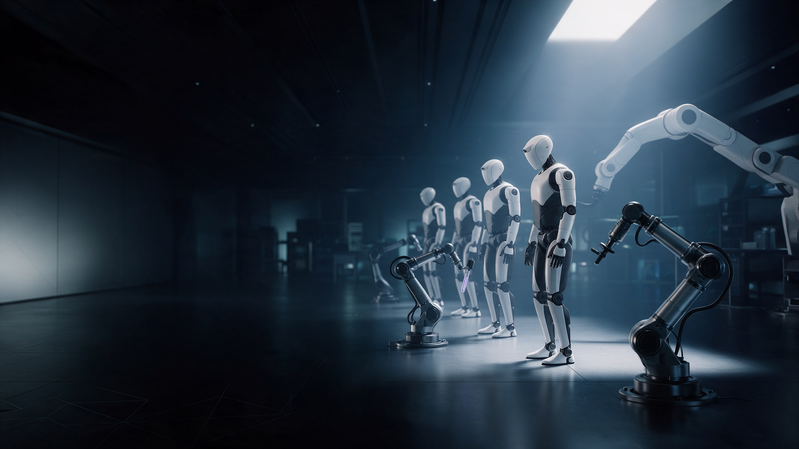

<div align="center">



# Bisman OS

**A macOS-inspired desktop that runs on top of Windows.**
Frosted glass, a magnifying dock, Spotlight-style search and a live wallpaper, with all your real Windows apps, files and settings.


</div>

---

## ✨ What it is

Bisman OS replaces the look and feel of the Windows desktop with a clean, Mac-like environment. It's a full-screen shell written in C# / WPF:

- **It doesn't change Windows.** No system files are touched. Exit at any time with the **← Windows** button (or `Ctrl+Shift+Q`) and you're back on the normal desktop.
- **Everything is real.** The dock shows your installed apps, the desktop shows your actual Desktop folder, and the battery, Wi-Fi, volume, CPU and memory readings are live.
- **It's one small `.exe`.** It builds with the .NET Framework that already ships with Windows.

## 🧭 Features

### Desktop
| | |
|---|---|
| 🖼️ **Live wallpaper** | A slow camera drift, a soft light sweep and floating particles. It pauses on its own when an app fills the screen. |
| 🎬 **Video wallpaper** | Use any `.mp4` (or other video) as the wallpaper. It plays muted, on a loop. |
| 🧊 **Frosted glass** | Windows, menus, the dock and widgets blur the wallpaper behind them. |
| 📁 **Real desktop icons** | Your Desktop folder, with drag-to-select, multi-select, moving icons as a group, dropping onto folders, rename and Recycle Bin. |
| 📊 **Widgets** | Clock, greeting, and live CPU, memory, battery and network. |

### Dock & menu bar
| | |
|---|---|
| 🔍 **Magnifying dock** | Icons swell under the pointer, and dots mark running apps. It stays on top of other apps and reserves the bottom of the screen the way a taskbar does. |
| ⌨️ **Alt + Windows** | Adds the app you're using to the Dock. On the desktop, it opens a searchable app picker instead. |
| ➕ **New shortcut** | Turns any app, file, folder or website into a desktop shortcut, and optionally pins it to the Dock. |
| 📶 **Menu bar** | Wi-Fi, battery, volume, Control Centre, notifications and the clock, plus a one-click **← Windows** exit. |

### Built-in apps
| App | What it does |
|---|---|
| **Start menu** | Windows 11 layout with pinned apps, an A–Z list of all apps, recommended files, and power options. |
| **Bisman Search** | Spotlight-style search across apps, settings, files and folders (through Windows Search). |
| **Control Centre** | Working Wi-Fi and Bluetooth toggles, volume, brightness, battery and Focus mode. |
| **Terminal** | A real `cmd.exe` with tabs, colours, history, `cd`, environment variables and Ctrl+C. |
| **Files** | A file browser with a sidebar, breadcrumbs, thumbnails, preview, search, copy/paste and rename. |
| **System Settings** | Accent colour, glass, wallpaper, dock, notifications, startup and shortcuts. |
| **Task Manager** | Live CPU and memory graphs, and a process list with End task. |
| **Calculator** | A Mac-style calculator with keyboard support. |

## ⌨️ Keyboard shortcuts

| Shortcut | Action |
|---|---|
| `Alt` + `Win` | Add the current app to the Dock |
| `Ctrl` + `Space` | Start menu |
| `Alt` + `Space` | Search |
| `Ctrl` + `Alt` + `Space` | Search from any app |
| `Ctrl` + `Alt` + `B` | Bring Bisman OS to the front |
| `Ctrl` + `Alt` + `T` | New Terminal |
| `Ctrl` + `Alt` + `E` | New Files window |
| `Ctrl` + `Alt` + `M` | Task Manager |
| `Ctrl` + `,` | System Settings |
| `Ctrl` + `W` / `Ctrl` + `M` | Close / minimise window |
| `Ctrl` + `` ` `` | Switch windows |
| `Ctrl` + `Shift` + `Q` | Exit to Windows |

## 🚀 Build & run

**Requirements:** Windows 10 or 11, and the [.NET SDK](https://dotnet.microsoft.com/download) (only its C# compiler is used; the app itself runs on the .NET Framework built into Windows).

```bash
git clone https://github.com/Bisman-Singh-Dev/Bisman-OS---Windows-Mac-Os.git
cd Bisman-OS---Windows-Mac-Os
build.bat
```

Then run `BismanOS.exe`, keeping it next to the `Assets` folder. To open it every time you sign in, turn it on in **System Settings → Startup**.

## 🧱 Project layout

```
src/
  Core.cs          theme, settings, native interop, UI helpers
  Sys.cs           battery, network, audio, brightness, CPU and memory
  Styles.cs        control templates (switches, sliders, menus, scrollbars)
  Visuals.cs       live/video wallpaper, frosted glass, window manager, dialogs
  Catalog.cs       installed apps, pins, recent files, search
  Desktop.cs       main window, menu bar, dock, desktop icons, widgets
  Overlays.cs      Start menu, search, Control Centre, notifications, onboarding
  Shellbar.cs      dock window, taskbar handling, shortcuts, Alt+Win pinning
  AppsTerminal.cs  Terminal
  AppsFiles.cs     Files
  AppsMisc.cs      Settings, Calculator, Task Manager, About
Assets/            wallpapers and illustrations
legacy/            the original single-file Bisman OS 1
build.bat          one-command build
```

## ⚠️ Good to know

- While Bisman OS runs, it hides the Windows taskbar so the dock can stay on screen. The taskbar comes back when you exit. If the app is ever force-closed, open it again and click **← Windows** to bring the taskbar back. You can also turn this off in **Settings → Desktop & Dock**.
- Other Windows apps (Chrome, Word and so on) still open in their normal windows. Bisman OS can't restyle them.
- **Use the fast graphics chip** (on by default) sets Windows' per-app GPU preference for `BismanOS.exe`, so laptops with a dedicated GPU run it smoothly.

## 🎨 Credits

The wallpapers and the robot companion illustration were generated with AI for Bisman OS. The fonts and icons are Segoe UI Variable and Segoe Fluent Icons, which come with Windows.

## 📄 License

[MIT](LICENSE) © 2026 Bisman Singh
